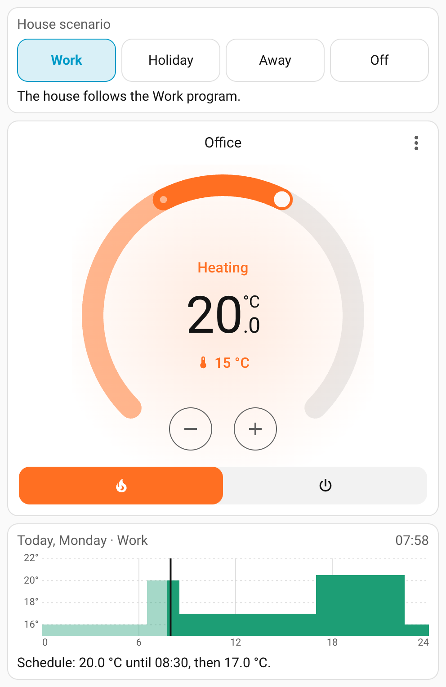
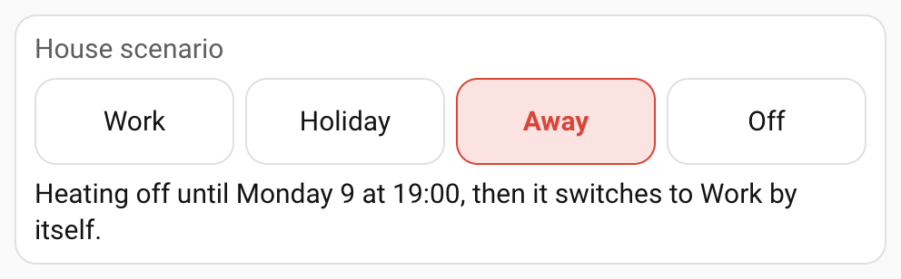
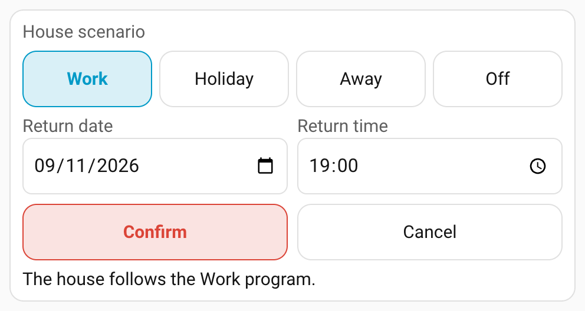
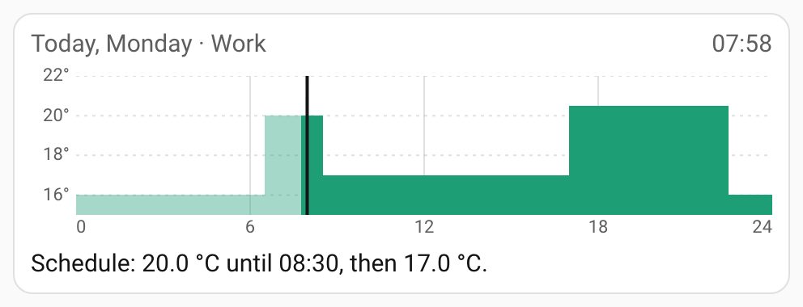
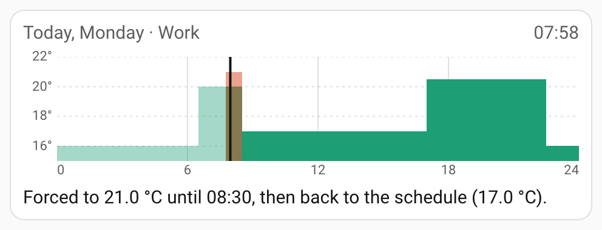
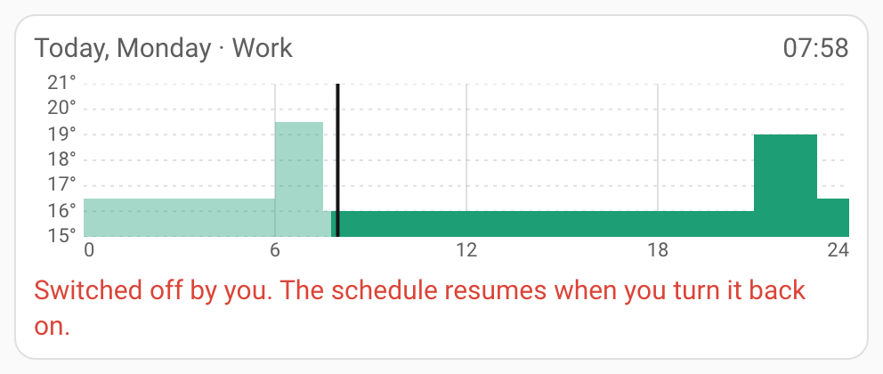
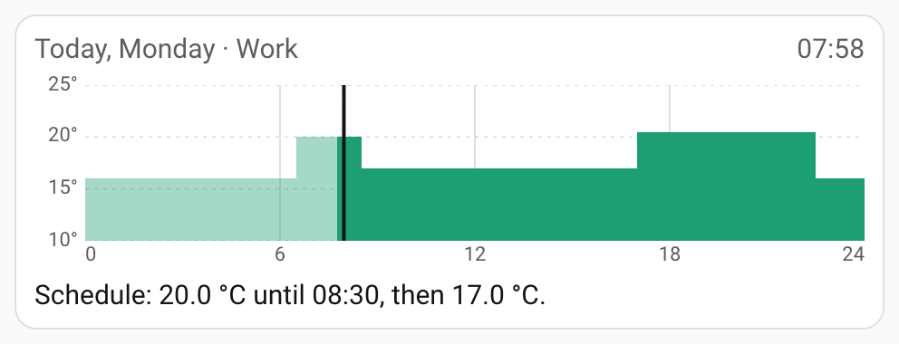
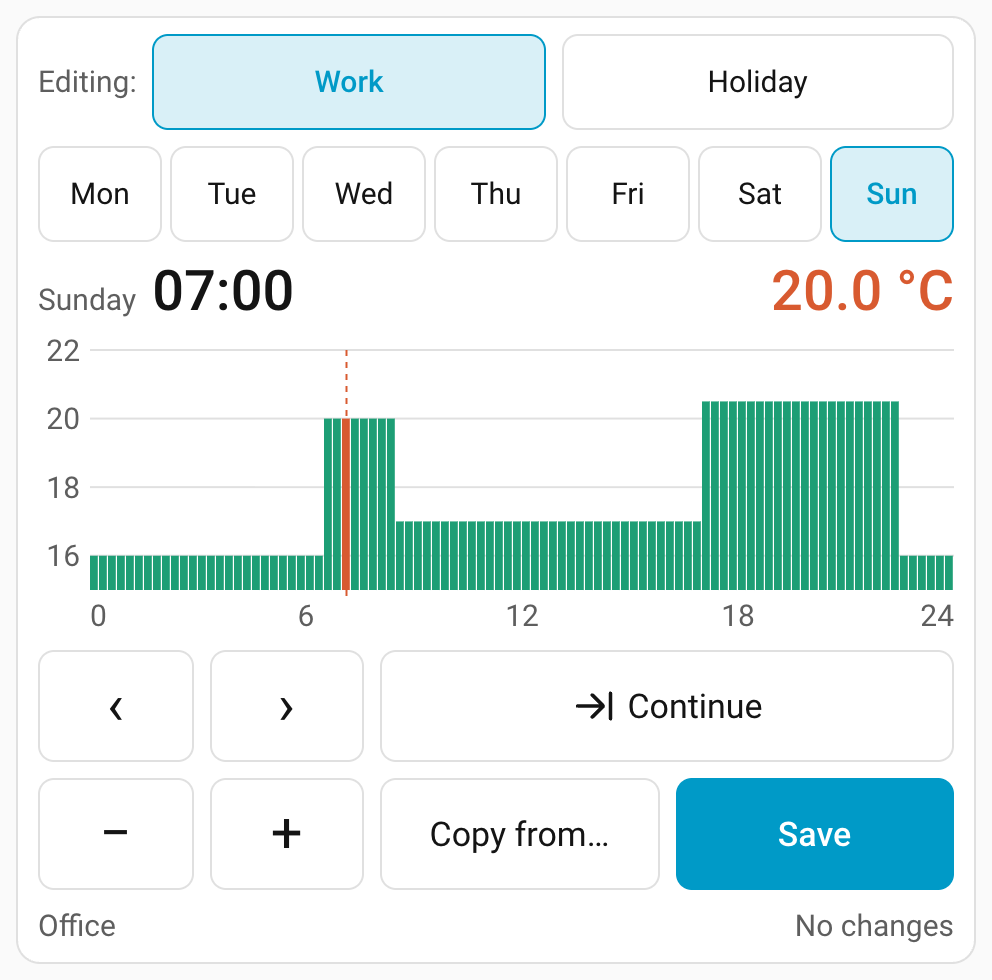

# Chronothermostat

A weekly heating program for Home Assistant `climate` entities that behaves like a
classic wall chronothermostat: one house-wide scenario, a quarter-hour program per
zone, and simple rules for what happens when somebody turns the dial.



- One **scenario** for the whole house: Work, Holiday, Away (until a return time) or Off.
- Every **zone** (a `climate` entity) has two weekly programs, Work and Holiday:
  seven days of 96 quarter-hour setpoints each, in 0.5 °C steps.
- The engine only acts on **program steps**, so a temperature set by hand on the
  thermostat is kept until the next step.
- Three Lovelace **cards** are bundled and registered automatically: a scenario
  card, a viewer that explains in one sentence what each zone is doing, and a
  touch-friendly program editor.
- Services, entities and an info-level log line for every command sent to a zone.

The cards are available in English and Italian, following the language of the Home
Assistant user. They are designed for wall panels as well as phones: every card fits
in 480 px of width and still works at 360 px.

## How it works

### Scenarios

| Scenario | What happens |
|---|---|
| **Work** | Every zone follows its Work program. |
| **Holiday** | Every zone follows its Holiday program. |
| **Away** | Every zone is switched off until the return date and time; at the return time the house switches to Work by itself. |
| **Off** | Every zone is switched off until another scenario is chosen (summer, long trips). |

Changing scenario takes effect immediately:

- to **Work** or **Holiday**: every zone is switched on (`heat`) and gets the value of
  the current quarter hour of its program, even if it was forced or switched off by hand;
- to **Away** or **Off**: every zone is switched off.

Away needs a return time in the future. Away set without a return time (for example
from the `select` entity) behaves like Off until a return time is set. If the return
time passes while Home Assistant is down, the house switches to Work at startup.

### The step rule

At every quarter hour (:00, :15, :30, :45, local time), for every zone that is on,
while the scenario is Work or Holiday, the engine compares the value of the quarter
hour that starts with the value of the previous one (at midnight: the last quarter of
the previous day). Only if they differ does it send `climate.set_temperature` with
the new value. Between two steps it does not touch anything.

### Manual changes

The thermostat stays the thermostat: the dial in Home Assistant, the device itself
and the mobile app keep working, and the rules around them are simple.

- **A setpoint changed by hand lasts until the next step.** Turn the dial and the zone
  keeps that temperature until the program makes its next step; then the program
  value wins. Example: program 19 °C from 07:00 to 09:00, then 15 °C; at 08:28 someone
  sets 22 °C: the zone stays at 22 °C until 09:00, then goes to 15 °C. The viewer
  shows it as *Forced to 22.0 °C until 09:00, then back to the schedule (15.0 °C).*
- **A zone switched off by hand stays off until someone switches it on again.** Program
  steps do not switch it back on. Switching it on (from `off` to `heat`, in Work or
  Holiday) re-applies the program value of the current quarter hour right away. A
  scenario change to Work or Holiday switches every zone back on.
- **A zone switched on by hand while the house is Away or Off is left alone.** It stays
  on, at the temperature set by hand, until someone switches it off or the scenario
  changes (to Work or Holiday: it follows the program; to the other "off" scenario: it
  is switched off like every other zone).

### Other details

- **Saving a program** does not re-apply it, with one exception: when the saved day is
  today, the program is the active one, the zone is on and the value of the current
  quarter hour changed, the new value is sent at once.
- **Restart**: at startup, zones that are on in Work or Holiday get the value of the
  current quarter hour, so the house follows the program even if a step passed while
  Home Assistant was down. A setpoint forced before the restart is lost.
- **Unavailable zones**: a command that cannot be delivered because the zone is
  unavailable is kept and retried when the zone comes back and at the next quarter
  hours, until it succeeds or a newer step replaces it. A short unavailable blip after
  each command (some wall thermostats do this) is not mistaken for the zone being
  switched off.
- **Comparisons** round the thermostat's setpoint to 0.5 °C and use a 0.05 °C tolerance,
  so a thermostat with a finer step (for example 18.96 °C) is not reported as forced.
- **Daylight saving time**: quarter hours follow the local clock. On the night the
  clock jumps forward, the steps of the skipped hour are lost; on the night it goes
  back, they are repeated.
- New zones start with a default program: 16 °C from 23:00 to 06:00 and 19 °C otherwise,
  every day, in both programs.

## Installation

Requires Home Assistant 2026.9 or newer, with temperatures in °C (metric unit system):
on a system set to °F the integration cannot be added and does not start.

### HACS (custom repository)

1. In HACS, open the menu (⋮) → **Custom repositories**.
2. Add `https://github.com/dbtswdev/chronothermostat` with type **Integration**.
3. Search for **Chronothermostat**, download it and restart Home Assistant.

HACS only works with public GitHub repositories (also as custom repositories), so
install from a public repository or a public fork.

### Manual

1. Copy the folder `custom_components/chronothermostat` of this repository into the
   `custom_components` folder of your Home Assistant configuration (create it if it
   does not exist), so that you have `config/custom_components/chronothermostat/manifest.json`.
2. Restart Home Assistant.

## Configuration

1. Go to **Settings → Devices & services → Add integration** and pick
   **Chronothermostat**.
2. Select the `climate` entities to manage as zones and submit.

The integration can be added once. To add or remove zones later, open the
integration and choose **Configure**: the integration reloads with the new list. The
status sensor of a removed zone is deleted, but its programs are kept, so adding the
zone back restores them.
A zone's name is the friendly name of its `climate` entity; the editor card accepts
an optional `name` to override it.

When the integration is added, and every time it reloads (after **Configure**, for
example), zones that are on in Work or Holiday are sent the value of the current
quarter hour of their program at once. For new zones that is the default program:
16 °C from 23:00 to 06:00 and 19 °C otherwise.

Programs, the scenario and the return time are stored by the integration (in
`.storage`), never in `configuration.yaml`. There is nothing to configure in YAML.
Deleting the integration also deletes its programs: adding it again starts from the
default program.

Zones are switched on with HVAC mode `heat` and off with `off`.

## Cards

The integration serves the cards from `/chronothermostat/chronothermostat-cards.js`
and adds that file to the dashboard resources by itself (dashboards in storage mode,
the default). After installing or updating, reload the browser page. For dashboards
in YAML mode see the [FAQ](#faq).

All three cards can be added from the dashboard editor (search for
"Chronothermostat") and have a visual editor: the zone, the axes and the chart height
for the viewer, the zone and the optional name for the editor, the optional name for
the scenario card.

A typical setup: an everyday view with the scenario card at the top and, for each
zone, the standard `thermostat` card followed by the viewer card; a separate view
with one editor card per zone.

```yaml
views:
  - title: Heating
    cards:
      - type: custom:chronothermostat-scenario-card
      - type: vertical-stack
        cards:
          - type: thermostat
            entity: climate.office
            features:
              - type: climate-hvac-modes
                hvac_modes: [heat, "off"]
          - type: custom:chronothermostat-viewer-card
            entity: climate.office
  - title: Programs
    cards:
      - type: custom:chronothermostat-editor-card
        entity: climate.office
```

### Scenario card

`custom:chronothermostat-scenario-card` — one per house. Four buttons, the active one
highlighted (Away and Off in red), and a sentence saying what the house is doing.
Work and Holiday apply at once; tapping the one already active does nothing, so zones
switched off or forced by hand stay as they are. Away asks for the return date and
time (rounded to the nearest quarter hour, pre-filled with tomorrow at 19:00) and Off
asks for confirmation.





```yaml
type: custom:chronothermostat-scenario-card
name: Heating   # optional, replaces the "House scenario" label
```

| Option | Required | Description |
|---|---|---|
| `name` | no | Label shown above the buttons. |

### Viewer card

`custom:chronothermostat-viewer-card` — one per zone, placed under the zone's
thermostat card. It shows today's program for the active scenario (temperature and
hour labels, past quarter hours dimmed, a line at the current time, a band for a
forced setpoint up to the next step) and one sentence:

| Zone status | Sentence |
|---|---|
| following the program | *Schedule: 19.0 °C until 09:00, then 15.0 °C.* |
| forced from the dial | *Forced to 22.0 °C until 09:00, then back to the schedule (15.0 °C).* |
| switched off by hand | *Switched off by you. The schedule resumes when you turn it back on.* (in red) |
| Away | *Away: off until Monday 9 at 19:00, then Work.* |
| Away without return | *Away with no return: stays off until you set a return.* |
| Off | *Heating off.* |
| switched on by hand while Away/Off | *Turned on by hand with the heating off: stays at 20.0 °C until you turn it off or change scenario.* |







```yaml
type: custom:chronothermostat-viewer-card
entity: climate.office
```

| Option | Required | Description |
|---|---|---|
| `entity` | yes | The zone's `climate` entity. |
| `name` | no | Accepted in YAML but not displayed (the zone is the one of the thermostat card above). |
| `show_temperature_axis` | no | Temperature labels on the left, with dashed reference lines. Default `true`. |
| `show_time_axis` | no | Hour labels (0, 6, 12, 18, 24) below the chart. Default `true`. |
| `scale` | no | Chart height: `auto` (default) spans one degree below the day's lowest value to one degree above its highest, at least five degrees; `fixed` uses `scale_min`–`scale_max`. |
| `scale_min`, `scale_max` | with `scale: fixed` | Bottom and top of the chart in °C; `scale_min` must be lower than `scale_max`. Values outside the range are drawn at the edge. |

All of them are in the card's visual editor. There the fixed range is limited to what
the zone's thermostat allows (its `min_temp`–`max_temp`, or 5–30 °C when it does not
report them): a value outside it, or a top not above the bottom, is refused with a
message and the card keeps its last valid configuration.

```yaml
type: custom:chronothermostat-viewer-card
entity: climate.office
scale: fixed
scale_min: 10
scale_max: 25
```



The viewer reads only the zone's status sensor and its `climate` entity. A short
unavailable blip of the thermostat (some wall thermostats have one after every
command) does not change the card: it says *Thermostat unavailable.* only when the
zone stays unavailable for more than 5 seconds.

### Editor card

`custom:chronothermostat-editor-card` — one per zone, best in a dedicated view.



- **Editing: Work · Holiday** chooses which program you edit; it does not change the
  scenario. It opens on the active program (Work when the house is Away or Off).
- **Mon … Sun** chooses the day; it opens on today.
- The reading row shows the cursor's time and temperature. Tap the chart to move the
  cursor to that quarter hour.
- **‹ ›** move the cursor by a quarter hour, **− +** change the cursor's temperature
  by 0.5 °C within the thermostat's limits. Keep them pressed to repeat.
- **Continue** copies the cursor's value into the next quarter hour and moves the
  cursor there (also repeats when kept pressed): "19 °C from 07:00 to 09:00" is one
  value plus a press on Continue.
- **Copy from…** lists the other six days; a tap copies that day's saved program onto
  the current day, which you then save.
- **Save** saves the current day. The status line says *No changes*, *Unsaved changes*
  or *Tuesday program saved*. Switching day or program with unsaved changes asks
  whether to save or discard them.

```yaml
type: custom:chronothermostat-editor-card
entity: climate.office
name: Office   # optional, shown under the buttons
```

| Option | Required | Description |
|---|---|---|
| `entity` | yes | The zone's `climate` entity. |
| `name` | no | Zone name shown in the card; defaults to the entity's friendly name. |

## Services

### `chronothermostat.set_scenario`

Switches the house-wide scenario.

| Field | Required | Description |
|---|---|---|
| `scenario` | yes | `work`, `holiday`, `away` or `off`. |
| `return_at` | for `away` | When the house returns to Work. Must be in the future; ignored for the other scenarios. |

A `return_at` without a timezone offset, such as `2026-12-27 19:00` (what the
service's date and time picker sends), is read in Home Assistant's time zone. A value
with an offset (`2026-12-27T19:00:00+01:00`) or from a template such as
`{{ now() + timedelta(days=2) }}` is used as it is. Times in the past are rejected.

```yaml
action: chronothermostat.set_scenario
data:
  scenario: away
  return_at: "{{ now() + timedelta(days=2) }}"
```

```yaml
action: chronothermostat.set_scenario
data:
  scenario: holiday
```

### `chronothermostat.set_program`

Replaces one day of a zone's program.

| Field | Required | Description |
|---|---|---|
| `zone` | yes | The zone's `climate` entity. |
| `program` | yes | `work` or `holiday`. |
| `weekday` | yes | `mon`, `tue`, `wed`, `thu`, `fri`, `sat` or `sun`. |
| `values` | yes | Exactly 96 numbers, one per quarter hour starting at 00:00. |

Values are rounded to 0.5 °C. A list with another length, with non-numeric values or
with values outside the thermostat's `min_temp`/`max_temp` is rejected and the stored
program is left unchanged. Saving today's day of the active program applies the new
current value at once (see [Other details](#other-details)).

```yaml
action: chronothermostat.set_program
data:
  zone: climate.office
  program: work
  weekday: mon
  # 16 °C until 06:30, 20 °C until 08:30, 17 °C until 17:00, 20.5 °C until 22:30, then 16 °C
  values: "{{ [16.0] * 26 + [20.0] * 8 + [17.0] * 34 + [20.5] * 22 + [16.0] * 6 }}"
```

### `chronothermostat.copy_day`

Copies one day of a zone's program onto another day.

| Field | Required | Description |
|---|---|---|
| `zone` | yes | The zone's `climate` entity. |
| `program` | yes | `work` or `holiday`. |
| `from_weekday` | yes | The day to copy. |
| `to_weekday` | yes | The day to overwrite. |

```yaml
action: chronothermostat.copy_day
data:
  zone: climate.office
  program: work
  from_weekday: mon
  to_weekday: tue
```

## Entities

All entities belong to one device, *Chronothermostat*.

| Entity | Description |
|---|---|
| `select.chronothermostat_scenario` | The scenario: `work`, `holiday`, `away`, `off`. Selecting `away` here keeps the stored return time; without one it behaves like Off. |
| `datetime.chronothermostat_return_at` | The return time of Away (`unknown` when there is none). Setting it while Away re-arms the return; a time in the past counts as no return. |
| `sensor.chronothermostat_<zone>_status` | One per zone: what the zone is doing (below). |

The status sensor's state is one of:

| State | Meaning |
|---|---|
| `schedule` | Work or Holiday, zone on, setpoint equal to the program value. |
| `forced` | Work or Holiday, zone on, setpoint different from the program value (until the next step). |
| `zone_off` | Work or Holiday, zone switched off by hand. |
| `zone_on_manual` | Away or Off, zone switched on by hand. |
| `away` | Away with a future return time, zone off. |
| `away_no_return` | Away without a return time, zone off. |
| `off` | Off, zone off. |

The sensor is `unavailable` while the zone's `climate` entity is unavailable or
missing. Attributes (the program ones are empty while the house is Away or Off):

| Attribute | Description |
|---|---|
| `zone` | The zone's `climate` entity id. |
| `program` | `work` or `holiday` while one of them is active, otherwise empty. |
| `program_target` | Program value of the current quarter hour. |
| `next_step_at` | Date and time of the next program step (ISO 8601). |
| `next_step_target` | Program value from the next step. |
| `today` | Today's 96 program values. |
| `return_at` | The return time of Away (ISO 8601), if any. |

Of these attributes only `zone` and `program` are recorded in the history database;
the others are derived from the program and left out to keep the database small.

## Logging

Every command sent to a zone is logged at `info` level with its reason (`step`,
`scenario <name>`, `return`, `zone_on`, `save`, `startup`, `retry`):

```text
INFO [custom_components.chronothermostat.engine] climate.office: set temperature 20.0 (step)
INFO [custom_components.chronothermostat.engine] climate.office: set hvac_mode off (scenario away)
```

To see them, enable info logging for the integration:

```yaml
logger:
  default: warning
  logs:
    custom_components.chronothermostat: info
```

## FAQ

**My dashboards are in YAML mode and the cards are not found.**
The integration can only add its resource when dashboard resources are in storage
mode; with `mode: yaml` (or `resource_mode: yaml`) it logs a warning with the line to
add. Add the bundle as a module resource, with the installed version (from
`manifest.json`) in the query string:

```yaml
lovelace:
  mode: yaml
  resources:
    - url: /chronothermostat/chronothermostat-cards.js?v=0.2.0
      type: module
```

Update the `v=` value after each update so browsers load the new cards.

**Can I install it from a private repository with HACS?**
No. HACS does not use private repositories, not even as custom repositories. Use a
public repository or install manually.

**I switched a zone on and the log shows nothing.**
When a zone is switched on and its setpoint already equals the program value, nothing
needs to be sent. Switching on a zone whose setpoint differs sends the program value
(reason `zone_on`).

**Why is my automation's `return_at` rejected?**
It is in the past. A time without offset is read in Home Assistant's time zone, which
may differ from the one of your browser or device; use a template such as
`{{ now() + timedelta(hours=36) }}` or write the offset explicitly.

**Does it work for cooling?**
No. Zones are switched on with HVAC mode `heat`.

## License

[MIT](LICENSE)
